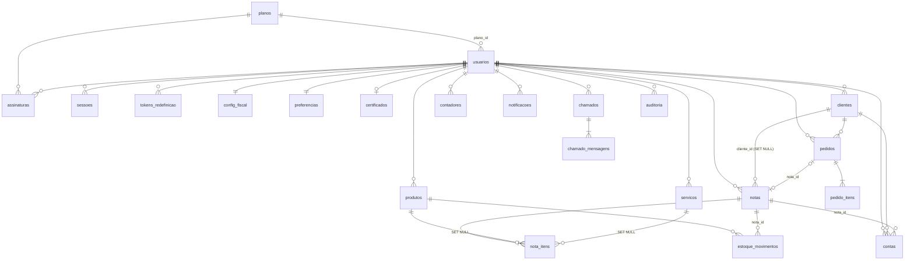

# Banco de dados

- **SGBD:** PostgreSQL 13 ou superior, validado com o 16.15 e o 16.10 (Docker). Em desenvolvimento e nos testes pode-se usar o PGlite, que roda o mesmo SQL.
- **Migrações:** os arquivos `db/migrations/NNN_nome.sql` são aplicados em ordem dentro de transações. O controle fica na tabela `schema_migrations`. Para aplicar, rode `npm run migrate`; a API também aplica as pendentes ao iniciar.
- **Multi-tenant:** toda tabela de negócio tem `usuario_id` com `ON DELETE CASCADE`, e todas as consultas filtram por esse campo. Isso substitui o RLS do Supabase que a FINC original usava.

## Diagrama entidade-relacionamento



## Tabelas

| Tabela | Finalidade e regras principais |
|---|---|
| `planos` | `basico` e `black`. Os limites (`limite_*`, em que NULL significa ilimitado) e os `detalhes` (JSON) são editáveis por SQL |
| `usuarios` | Conta e emitente. `email` é único e minúsculo. `cpf_cnpj` é único e só aceita 11 ou 14 dígitos. Senha em `scrypt`. `falhas_login` e `bloqueado_ate` controlam o bloqueio. `papel` é `usuario` ou `admin` |
| `sessoes` | Guarda só o hash SHA-256 do token. `expira_em` e `revogada_em` permitem revogar a sessão no servidor |
| `tokens_redefinicao` | Hash do token, validade de 1 h e uso único |
| `assinaturas` | Histórico de planos (status `ativa` ou `encerrada`) |
| `clientes` | PF ou PJ. `UNIQUE(usuario_id, cpf_cnpj)`. Endereço e contatos |
| `produtos` | NCM (8 dígitos), CFOP (4), ICMS e PIS/COFINS entre 0 e 100, origem de 0 a 8, `UNIQUE(usuario_id, sku)` e controle de estoque (`estoque_atual`, `estoque_minimo`) |
| `servicos` | CNAE (7 dígitos), código do serviço, item da LC 116, ISS entre 0 e 100. `codigo_interno` é único por conta quando informado |
| `contadores` | `UNIQUE(usuario_id, email)` |
| `config_fiscal` | Ambiente, série, `proximo_numero`, natureza da operação, CFOP padrão, regime tributário e `somar_impostos` |
| `preferencias` | JSON validado por `preferenciasSchema` |
| `notas` | Status `rascunho`, `emitida` ou `cancelada`. `numero` é único por (usuario, série) quando emitida. Guarda um snapshot JSON do emitente, do destinatário e do transporte, além dos totais calculados |
| `nota_itens` | Snapshot do item (descrição, NCM, CFOP, alíquotas) para que o documento não mude se o cadastro mudar |
| `estoque_movimentos` | Entradas, saídas e ajustes, com `saldo_apos` e referência à nota |
| `contas` | Contas a receber e a pagar (`aberta`, `paga` ou `cancelada`). Pode referenciar cliente e nota |
| `pedidos`, `pedido_itens` | Pedido de venda com número sequencial por conta. Status `aberto`, `faturado` ou `cancelado` |
| `notificacoes` | Notificações internas (lida ou não lida) |
| `chamados`, `chamado_mensagens` | Suporte. Autor `cliente` ou `suporte` |
| `feedbacks` | Feedback dos usuários |
| `certificados` | A1 cifrado com AES-256-GCM (arquivo e senha), mais os metadados (titular, documento, validade) |
| `auditoria` | Trilha de ações (`acao`, entidade, IP, detalhes) |

## Valores padrão dos planos

Os valores e limites da FINC original ficavam apenas no banco Supabase e não estavam versionados. Os números abaixo são o padrão da FINC 2.0, definido em `003_seed_planos.sql`:

| Plano | Valor/mês | Notas/mês | Clientes | Produtos | Serviços | Contadores |
|---|---|---|---|---|---|---|
| BÁSICO | R$ 29,90 | 30 | 100 | 100 | 50 | 1 |
| BLACK | R$ 79,90 | ilimitado | ilimitado | ilimitado | ilimitado | 5 |

Para ajustar, por exemplo:

```sql
UPDATE planos SET valor = 39.90, limite_notas_mes = 50 WHERE codigo = 'basico';
```

## Backup

- PostgreSQL: `pg_dump -Fc "$DATABASE_URL" > finc-$(date +%F).dump` para gerar o backup e `pg_restore -d "$DATABASE_URL" arquivo.dump` para restaurar.
- PGlite (somente desenvolvimento): copie o diretório configurado em `DATABASE_URL` com o servidor parado.
